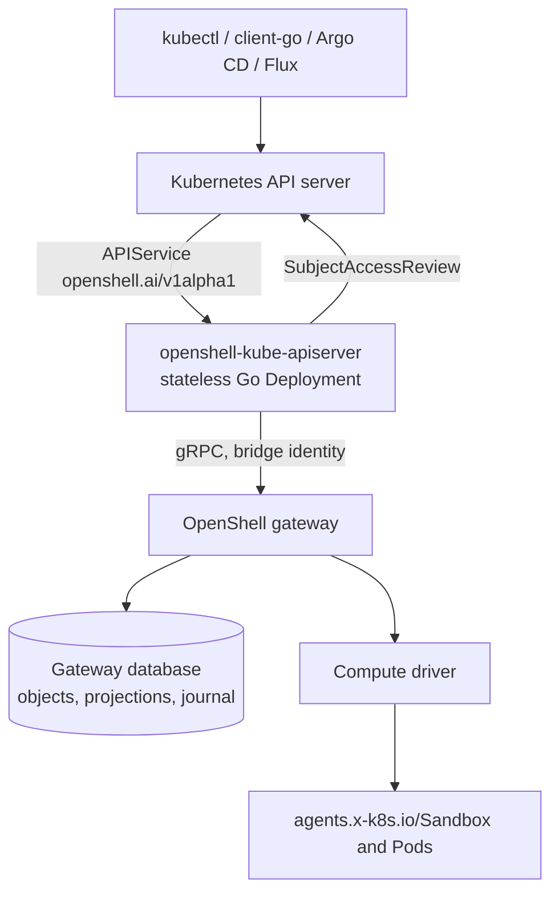

---
authors:
  - "@JimBugwadia"
state: draft
links:
  - https://github.com/NVIDIA/OpenShell/issues/5062
  - https://github.com/NVIDIA/OpenShell/issues/1719
---

# RFC NNNN - Kubernetes OpenShellSandbox API

<!--
See rfc/README.md for the full RFC process and state definitions. Do not
create an RFC until a GitHub issue exists and maintainers have assigned the
RFC number from that issue.
-->

## Summary

Add an optional Kubernetes API, `openshell.ai/v1alpha1`, that lets users create
and manage OpenShell sandboxes with `kubectl`, client-go, and GitOps tools. The
API serves a namespaced `OpenShellSandbox` resource and read-only
`OpenShellSandboxTemplate` and `OpenShellProvider` resources, plus a read-only,
cluster-scoped `OpenShellWorkspace` catalog.

A separate, stateless Go Deployment serves the API through Kubernetes API
aggregation and translates each request into gateway gRPC calls. There are no
`openshell.ai` CRDs and no copies of gateway domain objects in etcd. Kubernetes
still stores deployment infrastructure, APIService registration, RBAC, and Secrets.
The gateway database stays the single
source of truth; the gateway gains a small amount of metadata and a bounded
change journal so it can provide Kubernetes semantics such as
`resourceVersion`, watch, and server-side apply.

## Motivation

OpenShell sandboxes are created through the gateway using the CLI, SDKs, or
gRPC. Teams that run OpenShell on Kubernetes manage everything else with
`kubectl`, namespace RBAC, admission policy, and GitOps tools such as Argo CD
and Flux. For sandboxes they must instead script imperative CLI calls from CI,
manage access in a second authorization system, and give up drift detection,
`kubectl wait`, and Kubernetes audit.

The Kubernetes compute driver already creates `agents.x-k8s.io/Sandbox`
objects, but these are runtime implementation details. They do not carry the
OpenShell contract (policy, providers, workload templates), and editing them
bypasses the gateway. Templates and providers live only in the gateway, so a
Kubernetes user cannot discover what a sandbox may reference or diagnose a
failing one.

The conventional fix is a CRD and controller. That would copy desired state
into etcd while the gateway database remains authoritative. The two stores can
disagree after partial failures, CLI changes fight the controller, and each
sandbox adds etcd objects and watch traffic as agent density grows. API
aggregation lets Kubernetes route requests for the group to a server that reads
and writes the gateway directly, so there is one record per sandbox.

[#1719](https://github.com/NVIDIA/OpenShell/issues/1719) asks for
Kubernetes-native management of OpenShell, including gateway installation.
[#5062](https://github.com/NVIDIA/OpenShell/issues/5062) scopes this RFC to the
sandbox API. The design affects the public gateway contract, gateway
persistence, the Helm chart, and the security model, so it needs broad review.

## Non-goals

- Installing, upgrading, or configuring the gateway. The operator remains part
  of #1719.
- Creating, deleting, or changing namespaces or workspaces, or changing how the
  compute driver places runtime Pods.
- Writable template or provider resources. Providers hold credentials and need
  a separate Secret-reference design.
- Interactive access (exec, SSH, port forwarding) and policy-draft approval.
  These stay in the `openshell` CLI.
- Accepting arbitrary PodSpecs, Secret references, or privileged workload
  options beyond the existing gateway contract.
- Replacing the Agent Sandbox controller or bypassing the compute driver.
- Serving more than one gateway per cluster.

## Proposal

### Architecture



The extension API server (`openshell-kube-apiserver`) authenticates the
forwarded user, authorizes the request with Kubernetes RBAC, validates and
converts it, and calls the gateway. The gateway owns domain validation,
persistence, policy, providers, runtime creation, readiness, and cleanup. The
extension server never creates runtime objects and has no database, volume, or
direct database access. Clusters that do not install it are unaffected.

The server is written in Go using `k8s.io/apiserver` with custom REST storage
backed by gRPC instead of etcd. Go provides mature aggregated-server machinery
(delegated authentication and authorization, discovery, OpenAPI, patching,
field management); there is no Rust equivalent. It lives in a separate module,
`kubernetes/apiserver/`, ships as its own image, and uses the generated client
from `sdk/go/proto/openshellv1`.

### Resources

Resources use group `openshell.ai`, version `v1alpha1`. The table describes the
production target; the prototype's smaller surface is described in the
implementation plan.

| Kind | Scope | Short name | Gateway object | v1alpha1 verbs |
| --- | --- | --- | --- | --- |
| `OpenShellSandbox` | Namespaced | `oss` | `Sandbox` | create, get, list, watch, update, patch, delete, deletecollection; `status` (read-only) and `log` subresources |
| `OpenShellSandboxTemplate` | Namespaced | `osst` | `SandboxWorkloadTemplate` | get, list, watch |
| `OpenShellProvider` | Namespaced | `osp` | `Provider` | get, list, watch; credentials and credential handles are never returned |
| `OpenShellWorkspace` | Cluster | `osw` | `Workspace` | get, list, watch only |

The `OpenShell` prefix keeps `kubectl`, k9s, and Argo CD from confusing these
kinds with `agents.x-k8s.io/Sandbox`, as recommended in #1719.

**Namespaces.** The namespace name is the workspace name: an
`OpenShellSandbox` in namespace `team-a` is a sandbox in workspace `team-a`,
and Kubernetes RBAC decides who can act on it. There is no binding
configuration. Workspace names are DNS-1123 labels, so every workspace name is
a valid namespace name. Requests in a namespace with no matching workspace
fail with a clear error; list and watch return empty results. As with any
namespaced resource, deleting a namespace deletes the `OpenShellSandbox`
objects in it. Read-only kinds lack the `delete` verb, so the namespace
controller skips them.

All-namespace lists for sandboxes, templates, and providers query gateway
workspaces and preserve each object's workspace as `metadata.namespace`. They
require cluster-wide Kubernetes list authorization; a namespace RoleBinding does
not grant `-A` access.

The workspace catalog exposes existing gateway workspace names, labels, identity,
and lifecycle phase (`Active`, `Terminating`, or `Unknown`). It does not create
namespaces, manage workspaces, or introduce binding records. Catalog results
reflect the bridge identity's gateway visibility, not the requesting user's
namespace permissions. A separate cluster-scoped reader role grants only get/list.
Seeing a workspace does not grant sandbox access or guarantee that its Kubernetes
namespace exists.

### Example

```yaml
apiVersion: openshell.ai/v1alpha1
kind: OpenShellSandbox
metadata:
  name: research-agent
  namespace: team-a
  labels:
    team: a
spec:
  workloadTemplate: claude-code  # OpenShellSandboxTemplate in this namespace; or inline spec.template
  providers:                     # OpenShellProviders in this namespace
    - anthropic
  policy:                        # inline SandboxPolicy; there is no named policy object
    version: 1
    filesystem:
      includeWorkdir: true
      readOnly: []
      readWrite: []
    landlock:
      compatibility: ""          # best_effort | hard_requirement
    process:
      runAsUser: ""
      runAsGroup: ""
    networkPolicies:
      anthropic-api:
        endpoints:
          - host: api.anthropic.com
            port: 443
        binaries:
          - path: /usr/local/bin/claude
    networkMiddlewares: {}
  settings: {}
  command: ["claude"]
  restartPolicy: OnFailure       # Never | OnFailure | Always
  desiredState: Running          # Running | Stopped | Suspended
status:
  phase: Ready
  observedGeneration: 1
  conditions:
    - type: Ready
      status: "True"
    - type: PolicyLoaded
      status: "True"
    - type: ProvidersReady
      status: "True"
  createdFromTemplate:
    name: claude-code
    resourceVersion: "7"
  policy:
    source: Sandbox              # Sandbox | Global
    currentVersion: 1
  providers:
    - name: anthropic
      ready: true
  services: []
  restartCount: 0
  hostKeyFingerprint: SHA256:...
```

```shell
kubectl get osw
kubectl auth can-i create openshellsandboxes.openshell.ai -n team-a
kubectl get openshellsandboxtemplates,openshellproviders -n team-a
kubectl apply --server-side -f research-agent.yaml
kubectl wait --for=condition=Ready openshellsandbox/research-agent -n team-a
kubectl get openshellsandboxes -A -w
kubectl get --raw /apis/openshell.ai/v1alpha1/namespaces/team-a/openshellsandboxes/research-agent/log
kubectl patch openshellsandbox research-agent -n team-a --type merge -p '{"spec":{"desiredState":"Stopped"}}'
kubectl delete openshellsandbox research-agent -n team-a
```

The readiness watch, log read, and spec patch above describe the production
target, not commands supported by the current prototype. For a working
workspace -> template -> sandbox demonstration, the prototype creates the workspace
and template with the existing CLI, creates the matching Kubernetes namespace
and scoped RoleBinding, then applies a sandbox referencing `spec.workloadTemplate`.
The workspace and template remain read-only through this API.

### Spec mapping and mutability

The spec is a curated view of the gateway's `CreateSandboxRequest`, not a
PodSpec and not raw protobuf JSON. Field names are camelCase. Driver
configuration keeps the driver's existing snake_case keys inside a
driver-keyed envelope, and the gateway's administrator gate for caller driver
configuration still applies. The server supplies `request_id`; users never
author it.

The gateway has targeted live-update operations and a separate
`SandboxUpdates.UpdateSandbox` service for storage-preserving configuration
updates. That service requires sandbox updates to be enabled and the sandbox to
be stopped, including for metadata-only edits; the published 0.1.6 demo gateway
does not expose it. It is not the atomic multi-field live-update contract proposed
below. The production API allows the supported changes in this table; changing any other field
returns a field-specific "delete and recreate" error and never triggers
automatic replacement.

| Field | Meaning | After creation | Gateway operation |
| --- | --- | --- | --- |
| `workloadTemplate` or `template` | Named template (resolved once) or inline image, environment, log level, and resources; mutually exclusive | Fixed | `CreateSandbox` |
| `command`, `tty`, `restartPolicy`, driver config, service exposures, GPU request | Workload process and placement | Fixed | `CreateSandbox` |
| `providers` | Provider names in the same workspace | Updatable | `AttachSandboxProvider`, `DetachSandboxProvider` |
| `policy.networkPolicies`, `policy.networkMiddlewares` | Endpoints, allowed binaries, request middleware | Updatable | `UpdateConfig` |
| `policy.filesystem` paths | Read-only and read-write paths | Add only; effective on next restart | `UpdateConfig` |
| `policy.filesystem.includeWorkdir`, `policy.landlock`, `policy.process` | Applied at startup | Fixed | `CreateSandbox` |
| `settings` | Sandbox-scoped gateway settings | Add or change; removal rejected | `UpdateConfig` |
| `desiredState` | Lifecycle intent | Updatable | Lifecycle RPCs below |

`desiredState` holds user intent; `status.phase` reports the result. This is
the pattern Kubernetes uses for `Job.spec.suspend` and KubeVirt uses for
`spec.runStrategy`.

| Value | Meaning | Gateway action |
| --- | --- | --- |
| `Running` (default) | Sandbox should run | `StartSandbox` from Stopped; `ResumeSandbox` from Suspended |
| `Stopped` | Compute released; record, policy, and providers kept | `StopSandbox` from Ready, Suspended (discards memory), or Error |
| `Suspended` | Workload frozen with memory retained | `SuspendSandbox`; rejected when the driver lacks suspend support |

Deletion is `kubectl delete`, not a state. When the main process exits, the
sandbox reaches `Completed` or `Error` according to `restartPolicy`, whatever
`desiredState` says.

One apply can change several updatable fields. Composing targeted RPCs is not
atomic, so the gateway needs an additive or extended update contract that applies providers,
network policy, settings, lifecycle intent, and metadata in one transaction
with `expected_resource_version` and `request_id`, reusing existing per-field
validation. This must preserve the separate update service's stopped-sandbox and
opt-in requirements rather than assuming it supports live mutations. Until an
appropriate atomic contract exists, production support must restrict requests to
one independently atomic field group. The prototype rejects all spec edits.
Lifecycle RPCs also need version preconditions, and
`SuspendSandbox` and `ResumeSandbox` need `request_id`.

### Spec ownership and drift

For fixed fields, `spec` returns what the user authored, so applying the same
manifest is a no-op even though the gateway stores the expanded template. For
updatable fields, `spec` returns current gateway state, so CLI changes appear
as drift instead of being silently reverted. Three gateway behaviors need
explicit rules:

- Provider attachments add composed `_provider_*` network policy entries.
  `spec.policy` returns the base policy only (the equivalent of
  `openshell policy get --base`); composed entries appear in status.
- Approved policy drafts change the base network policy. A GitOps tool with
  self-heal reverts them. This RFC leaves open whether a sandbox can hand
  network-policy ownership to the gateway.
- A gateway-wide global policy overrides the sandbox policy at runtime.
  `status.policy.source: Global` and the `PolicyLoaded` condition report it.

### Status and subresources

Status is read-only and derived from gateway state: phase, conditions, exit
code, restart count, template provenance, policy source and loaded version
(`GetSandboxPolicyStatus`), per-provider readiness
(`GetSandboxProviderStatus`), service URLs (`ListServices`), and the SSH host
key fingerprint. The `Ready` condition reflects gateway readiness and
configuration admission, not Pod presence, so `kubectl wait` is meaningful.
Fields that come from separate RPCs appear in watch events only if the gateway
journals them; otherwise they are best-effort on GET.

The `log` subresource is backed by `GetSandboxLogs` and authorized through
`openshellsandboxes/log`. The server emits no Kubernetes Event objects, which
avoids another stream of etcd writes; it exposes logs and metrics instead.

### Kubernetes semantics

These are production requirements, not claims about the prototype. Watch applies
to the three namespaced resources and the cluster-scoped workspace catalog.

| Operation | v1alpha1 behavior |
| --- | --- |
| Discovery, OpenAPI, table output | Schemas and discovery served locally; table formatting needs no additional gateway call |
| CREATE | Gateway object and Kubernetes projection admitted atomically |
| GET, LIST | Consistent snapshot; full label selector syntax including set-based selectors; field selectors on `metadata.name` and `metadata.namespace`; snapshot-safe continuation |
| WATCH | Per namespace and across all namespaces (`-A`), or cluster-scoped for workspaces; resumable from a list `resourceVersion`, with tombstones and `410 Gone` on expiry |
| UPDATE, PATCH | JSON merge patch, JSON patch, and server-side apply with managed fields; no strategic merge patch |
| DELETE, DELETECOLLECTION | Durable gateway admission with UID and version preconditions; acknowledge before waiting for original-UID removal |
| Dry-run | Validation without persistent writes or runtime side effects |

`generation` increments only on spec changes, and `observedGeneration` shows
when the gateway has applied them. v1alpha1 rejects finalizers and owner
references and accepts only default deletion with zero or omitted grace
period. Kubernetes tooling annotations such as
`kubectl.kubernetes.io/last-applied-configuration` are accepted up to
Kubernetes limits; because gateway annotation values are capped at 8 KiB, they
are stored in the projection rather than gateway `ObjectMeta`.

Creation also records a canonical last-applied snapshot of authored spec and user
metadata when the client has not supplied one. This permits unchanged client-side
apply after plain `kubectl create`, without an extra metadata adoption write.
Exclude status, server-owned metadata, and the annotation itself, and preserve a
client-supplied snapshot. Existing objects are not implicitly backfilled.

DELETE must not wait for runtime teardown before returning an acknowledgement.
Once the gateway durably accepts deletion, kubectl prints its `deleted` line and
then waits for the original UID to disappear; a same-name replacement must not
extend the wait. `--wait=false` skips the client wait, not durable admission.
The adapter must not acknowledge an unsubmitted local background task. The gateway
owns deletion recovery; no adapter queue or persistent deletion state is added.

The prototype implements this with an independently bounded delete RPC and
gateway polling, plus a named, UID-aware deletion watch. Its completion condition
is gateway record removal. The published gateway can remove its record while
driver cleanup is still running, so this does not guarantee that underlying
Pod finalizers have completed. Production must qualify the gateway's removal
boundary against the intended cleanup guarantee rather than infer it from RPC
return alone.

### Gateway persistence changes

No new storage service is added. The production design adds three logical record
types through gateway migrations for SQLite and PostgreSQL; it does not introduce
an adapter database or etcd domain storage. The read-only workspace catalog uses
existing workspace records without a separate projection record; production
resumable workspace watches also require entries in the shared change journal.

| Record | Contents | Retention |
| --- | --- | --- |
| Sandbox projection | Authored create form, generation, observed generation, desired lifecycle state, managed fields, Kubernetes tooling annotations | One per sandbox; deleted with the sandbox |
| Change journal | Revision, epoch, object type, workspace, object ID, event type, projected object | Pruned by age and size, for example 15 minutes or 50 MB |
| History epoch | Current epoch and oldest retained revision | One row; rotated on restore or reseed |

| Kubernetes field | Source |
| --- | --- |
| `metadata.name`, `namespace`, `uid`, `labels`, `annotations`, `creationTimestamp` | Gateway `ObjectMeta`, workspace, and projection for tooling annotations |
| `metadata.deletionTimestamp` | Durable gateway deletion admission time; requires a stable persisted timestamp |
| `metadata.resourceVersion` | Journal revision |
| `metadata.generation`, `managedFields`, fixed spec fields, `desiredState`, `status.observedGeneration` | Projection |
| Updatable spec fields and other status | Current gateway state |

The authored create form is needed because the gateway stores the expanded
spec; returning expanded values would make every apply show drift.
`desiredState` is stored because phases are ambiguous: `Error` does not say
whether the user still wants the sandbox running. CLI lifecycle commands update
the same field, so both views agree. CLI-created sandboxes get a projection at
creation; sandboxes that predate the feature appear after an explicit
administrative import.

The journal must assign revisions in commit order on both databases; a plain
sequence is insufficient because transactions can commit out of allocation
order. Every change that alters the returned representation (CLI mutations,
status reconciliation, imports, and deletions) writes a journal entry in the
same transaction. Gateway maintenance compacts the journal even when the
extension server is disabled.

The prototype has no journal or epoch records. It stores authored spec,
generation, and managed fields in the gateway sandbox annotation
`kubernetes.openshell.ai/prototype-projection`, hidden from Kubernetes responses,
and stores last-applied configuration as an ordinary annotation. Each annotation
is bounded to the gateway's 8 KiB value limit, with oversized writes rejected
before mutation. These are persistent additions to the existing gateway record,
not volatile adapter state. Adapter restart restores them directly from the
gateway; out-of-band spec edits are not reconciled into the authored snapshot.
This bounded envelope proves apply mechanics but is not the proposed production
projection contract or a migration format.

### Authentication and authorization

The server validates the front-proxy client certificate using the
request-header configuration that Kubernetes publishes, accepts forwarded
identity headers only after that check, and authorizes every request with
SubjectAccessReview. Anonymous access is disabled.

Kubernetes projects the server's short-lived ServiceAccount credentials for
delegated authentication and authorization; no manually issued long-lived
Kubernetes token is needed. Gateway authentication is a separate connection,
using gateway-trusted mTLS or a short-lived bearer token read from a mounted file.
The Kubernetes token is not automatically a valid gateway credential; a gateway
using that token must explicitly support and validate its issuer and audience.

The server calls the gateway with its own narrowly scoped identity: membership
in the workspaces served through Kubernetes and only the scopes the enabled
verbs need. It never uses the gateway operator certificate, which can export
credentials. Kubernetes RBAC therefore authorizes end users and the gateway
authorizes the bridge; per-user gateway ACLs are not evaluated. The server
records the Kubernetes user, request ID, and verb in its audit output.

Workspace catalog get/list/watch access uses a separate cluster-scoped reader role. Namespace
roles grant sandbox verbs (including get/list/watch for deletion waits) and
template/provider reads, not catalog access. The catalog is not a gateway
per-user authorization report and may expose workspace names outside a caller's
namespace access; administrators opt in to that visibility explicitly.

Updatable policy uses `UpdateConfig`, which requires the workspace `admin`
role. Administrators can disable policy and settings updates through the
Kubernetes API by configuration. Receiving `openshellsandboxes` RBAC grants no
access to runtime Pods, Secrets, or `agents.x-k8s.io/Sandbox` objects; in
`operator` workspace mode those objects share the namespace, so RBAC must be
granted per resource.

### Availability and operations

Aggregated APIs sit on the critical path for namespace deletion and garbage
collection. If the APIService is unavailable, discovery fails and namespace
deletion stalls across the cluster. The server therefore runs at least two
replicas with a PodDisruptionBudget, serves discovery and OpenAPI locally, and
returns `503` with a clear message when the gateway is unreachable, never an
empty successful list. Readiness requires initialized authentication trust and
a compatible, reachable gateway. Removing the APIService is the documented
recovery step and does not delete gateway sandboxes.

Packaging is an opt-in Helm component with its own ServiceAccount, TLS
identity, APIService with a CA bundle (never `insecureSkipTLSVerify`), RBAC,
NetworkPolicy, probes, and resource limits. It is disabled by default, and
existing chart behavior is unchanged.

## Implementation plan

The work is incremental and opt-in. Gateway changes are additive and land
first; the extension server ships as an alpha image behind a disabled Helm
flag.

The existing prototype precedes these production gateway changes. Its single
replica, broad local mTLS identity, and standalone demo manifests are development
fixtures, not the proposed HA Helm packaging or production credential scope.

1. **Prototype.** A Go aggregated server now exercises sandbox create/get/list/
   delete and bounded update/patch/apply, read-only templates/providers, and the
   cluster-scoped workspace catalog. Typed OpenAPI v2/v3 supports ordinary
   validation without `--validate=false`. New sandboxes save last-applied
   configuration automatically; plain create followed by unchanged apply works.
   Existing annotation-less objects still need a compatible metadata-update RPC
   for adoption. All-namespace lists and short names are implemented. Sandbox
   watch is limited to named, UID-aware deletion tracking. Workspace catalog
   watch replays current matches and polls once per second for additions,
   modifications, and deletions, with name and label filtering. It retains only
   a per-watch in-memory snapshot, adding no persistent state. Lists return
   resource version `0`; watches accept empty or `0` versions, while nonzero
   versions return 410 and require relisting. Initial objects can be repeated
   after a list or reconnect. Gateway errors terminate the stream; transient
   changes between polls can be missed. This is not historical replay, a
   consistent list/watch handoff, or a general change stream. The workspace-reader
   role grants get/list/watch, never workspace mutations.
   All spec edits, dry-run, subresources, and deletecollection remain unsupported.
   Metadata-changing apply requires the separate update service, updates enabled,
   and a stopped sandbox; it does not work on the pinned 0.1.6 gateway.
2. **Gateway foundations.** Projection records, the commit-ordered journal,
   history epochs, conditional deletion, side-effect-free validation for
   dry-run, and the `UpdateSandbox` RPC, with tests for commit ordering,
   snapshot pagination, crash recovery, and idempotency on both databases.
3. **Qualified v1alpha1 behavior.** Watch, updates, server-side apply, dry-run,
   full selectors, the `log` subresource, status projection, and error mapping
   (409 conflicts, 410 expired history, 422 invalid fields, 503 gateway
   unavailable). Validate with client-go informers and real `kubectl apply`,
   `diff`, `wait`, and delete.
4. **Packaging.** Helm component, certificate wiring and rotation, RBAC,
   NetworkPolicy, probes, compatibility preflight, and a Kubernetes E2E lane
   covering namespace deletion, replica failover, and gateway outages.
5. **Documentation and GitOps qualification.** Published docs for fields,
   limits, trust boundaries, and troubleshooting; pinned Argo CD and Flux tests
   for create, reapply, drift, prune, and outage recovery. Only configurations
   that pass are documented as supported.

The real-gateway prototype runs on an isolated kind cluster with the published
0.1.6 Helm chart and matching gateway, sandbox, and supervisor images.
`kind-demo.sh up` reuses that cluster, preserves sandboxes and valid serving
credentials, refreshes the isolated kubeconfig, and reconciles the adapter.
Setup prepares `team-a` and `team-b` gateway workspaces, matching Kubernetes
namespaces and demo-user RoleBindings, and a workspace-local `ubuntu-demo` template
in each. It deploys only `team-a/worker` and verifies inherited environment by exec.
`team-b` is left without a sandbox on fresh setup for the user to deploy
`demo-interactive-sandbox.yaml` interactively. `template-demo` repeats this scenario
without rebuilding the adapter; reruns preserve user-created `team-b` sandboxes
and do not remove resources from the earlier `api-demo` scenario.
The separate `test` scenario uses
disposable `default/demo` and `default/demo-ssa` names and deletes them.

Verification includes actual kubectl create/apply, SSA conflicts, typed schema
validation, namespace and catalog RBAC, all-namespace lists, persistence across
adapter restart, and gateway/workload identity agreement. Deletion integration
tests hold gateway admission and cleanup separately to prove acknowledgement
ordering, waiting, and original-UID tracking across replacement and relist.
Real-gateway testing also verifies early acknowledgement when the gateway record
disappears before the driver RPC finishes. The prototype has passed Go race tests,
vet, build, and the relevant demo checks; this does not qualify general informers,
Argo CD, Flux, or production HA.

## Risks

- **Kubernetes API surface.** Watch, apply, and selectors have subtle
  semantics. Mitigation: reuse upstream libraries, gate on real-client tests,
  and advertise only qualified semantics. The prototype proves managed-field
  handling with custom storage, but its workspace/deletion polling watches and bounded
  annotation projection are not substitutes for a production journal.
- **Gateway write amplification.** Journaling every representation change adds
  writes and may serialize a hot path. Mitigation: benchmark commit ordering
  and coalesce status updates without dropping required revisions.
- **Concentrated authority.** The bridge identity can act in every served
  workspace, and anyone who can create a namespace named after a workspace
  gains that reach. Mitigation: narrow scopes, protected credentials,
  Kubernetes audit, and an optional workspace allowlist (open question).
  Cluster-scoped workspace discovery is a separate metadata-disclosure decision,
  not proof that the caller may use each listed workspace.
- **Availability coupling.** An unavailable APIService stalls namespace
  deletion cluster-wide. Mitigation: HA packaging, local discovery, and a
  documented removal procedure.
- **Mixed mutability.** Some fields update in place, others require recreate,
  and CLI changes appear as drift. Mitigation: a documented field table,
  precise errors, and no silent reverts.
- **Maintenance cost.** A Go module with Kubernetes dependencies adds version
  coordination. Mitigation: pin a supported Kubernetes range and keep the
  component independently releasable.

## Alternatives

### CRD and controller

The conventional approach, with storage, watch, and field management provided
by Kubernetes. It stores a second desired-state record in etcd, which must be
reconciled with the gateway and conflicts with CLI changes. Worth revisiting if
gateway journal changes prove too costly.

### Stateless CRUD-only facade

Translate requests without any gateway persistence changes. It is enough for
basic CRUD but cannot durably preserve apply ownership or authored input after
template expansion. The prototype's bounded gateway annotation envelope supports
those apply cases without schema migrations, but adds persistent metadata and
still cannot provide consistent list/watch history. It is not sufficient to
qualify general GitOps behavior.

### Rust aggregation server

Matches the main codebase and could reuse `openshell-sdk`, but Rust lacks a
generic aggregated API server library. The component is a separate container,
so language choice does not affect the gateway.

### Expose `agents.x-k8s.io/Sandbox` directly or do nothing

Exposing runtime objects leaks compute details and bypasses gateway policy,
providers, and lifecycle. Doing nothing leaves Kubernetes users with
imperative CLI scripting and a second authorization system.

## Prior art

- [Kubernetes API aggregation](https://kubernetes.io/docs/concepts/extend-kubernetes/api-extension/apiserver-aggregation/)
  and [aggregation-layer authentication](https://kubernetes.io/docs/tasks/extend-kubernetes/configure-aggregation-layer/)
  define APIService routing, the five-second discovery budget, and front-proxy
  trust.
- [metrics-server](https://github.com/kubernetes-sigs/metrics-server) serves
  `metrics.k8s.io` through aggregation from a non-etcd backend, showing that
  custom REST storage is a supported pattern.
- [KubeVirt](https://kubevirt.io/user-guide/compute/run_strategies/) uses
  `spec.runStrategy` for lifecycle intent, the model for `desiredState`.
- [lensapp/openshell-k8s-operator](https://github.com/lensapp/openshell-k8s-operator)
  demonstrates a thin OpenShell gateway frontend backed by CRDs; this RFC keeps
  its user experience but drops the etcd copy.
- [RFC 0006](../0006-driver-config-passthrough/README.md) defines the driver
  configuration envelope reused by `spec.driverConfig`.

## Open questions

- Is `openshell.ai/v1alpha1` with three namespaced kinds and a read-only,
  cluster-scoped workspace catalog the right group and scope?
- Should the gateway extend its separate stopped-sandbox update service or add
  a distinct atomic live-update contract, or should v1alpha1 permit only one
  independently atomic field group per request?
- Should network-policy updates through Kubernetes be allowed, given that
  `UpdateConfig` requires the workspace `admin` role?
- How should approved policy drafts interact with GitOps self-heal: can a
  sandbox hand network-policy ownership to the gateway?
- Do clusters where users can create namespaces need a gateway-side allowlist
  of workspaces served through Kubernetes?
- Should the gateway audit log record the forwarded Kubernetes username?
- Are the projection, journal, and epoch records acceptable additions to the
  gateway database?
- Is explicit import of pre-existing sandboxes required for the first alpha?
- What cleanup boundary must gateway record removal guarantee, and how should
  clients diagnose a delete accepted earlier but later rolled back?
- Which Kubernetes, Argo CD, and Flux versions form the initial support matrix?
- Should the `log` subresource support `follow`, and should the project ship
  Argo CD health checks for these kinds?
